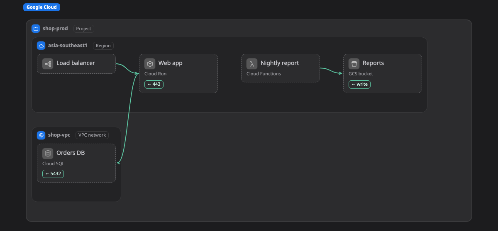

# Google Cloud

หน้านี้รวม kind ทั้งหมดของ Google Cloud ที่ Walkboard รู้จัก คือ box, zone และ line ที่วาดบน [map](../pictures/map.md) ได้ และบอกว่าแต่ละอย่างมักอยู่ตรงไหน

ถ้า box มี kind จากหน้านี้ map จะแสดง icon และ field ของมัน ถ้าวางไว้นอก zone ที่อยู่ในคอลัมน์ "มักอยู่ใน" จะมีป้าย ⚠ เล็กๆ ขึ้นข้างชื่อ เป็นแค่คำเตือน ถ้าตั้งใจวางแบบนั้นก็ไม่เป็นไร อ่านว่า kind ทำงานยังไงได้ที่หน้า[แพลตฟอร์ม](README.md)

[เปิด map นี้ใน live example แล้วคลิก box เพื่อดู kind ของมัน ↗](https://aiyaruch1320.github.io/walkboard/examples/platforms.html?view=gcp&step=all)

## Zone

zone คือกรอบที่มี box หรือ zone อื่นอยู่ข้างใน

| Kind | มักอยู่ใน | หมายเหตุ | ชื่ออื่น | Field |
|---|---|---|---|---|
| **Organization** `gcp:org` | ที่ไหนก็ได้ |  |  |  |
| **Folder** `gcp:folder` | [Organization](#org), [Folder](#folder) |  |  |  |
| **Project** `gcp:project` | [Organization](#org), [Folder](#folder), [Shared VPC host project](#sharedvpc), [VPC Service Controls perimeter](#perimeter) |  |  |  |
| **VPC network** `gcp:vpc` | [Project](#project) |  |  |  |
| **Region** `gcp:region` | [Project](#project), [VPC network](#vpc) |  |  |  |
| **Zone** `gcp:zone` | [Region](#region) |  |  |  |
| **Subnet** `gcp:subnet` | [VPC network](#vpc), [Region](#region) |  |  | cidr |
| **Firewall rule** `gcp:firewall` | [VPC network](#vpc), [Subnet](#subnet) | box ข้างในจะถูกเช็กกับ zone ที่ครอบมันอีกชั้น | security group | rules |
| **Shared VPC host project** `gcp:sharedvpc` | [Organization](#org), [Folder](#folder) |  | host project, xpn |  |
| **VPC Service Controls perimeter** `gcp:perimeter` | [Organization](#org), [Folder](#folder) | box ข้างในจะถูกเช็กกับ zone ที่ครอบมันอีกชั้น | service perimeter, vpc sc |  |

## Box

box คือ resource หนึ่งตัว เช่น server, database หรือ queue

| Kind | มักอยู่ใน | หมายเหตุ | ชื่ออื่น | Field |
|---|---|---|---|---|
| **Compute Engine VM** `gcp:gce` | [Subnet](#subnet), [Zone](#zone) | เป็น box หรือเป็น zone เมื่อมีอะไรรันอยู่ข้างใน; มี [Container](container.md) อยู่ข้างในได้ | vm, server, instance | type; os |
| **GKE cluster** `gcp:gke` | [VPC network](#vpc), [Region](#region), [Subnet](#subnet) | เป็น box หรือเป็น zone เมื่อมีอะไรรันอยู่ข้างใน; มี [Kubernetes](k8s.md) อยู่ข้างในได้ | kubernetes, k8s | mode (autopilot, standard) |
| **Cloud Run** `gcp:cloudrun` | [Region](#region), [Project](#project), [Subnet](#subnet), [VPC network](#vpc) |  | container, serverless | cpu; memory |
| **Cloud Functions** `gcp:functions` | [Region](#region), [Project](#project), [Subnet](#subnet), [VPC network](#vpc) |  | function, serverless | runtime |
| **Load balancer** `gcp:loadbalancer` | [Project](#project), [VPC network](#vpc), [Region](#region) |  | lb | scheme (external, internal) |
| **Private Service Connect endpoint** `gcp:psc` | [Subnet](#subnet), [VPC network](#vpc) |  | private endpoint, private link |  |
| **Identity-Aware Proxy** `gcp:iap` | [Project](#project) |  | zero trust |  |
| **Apigee** `gcp:apigee` | [Project](#project), [Region](#region) |  | api gateway |  |
| **Cloud Armor** `gcp:armor` | [Project](#project), [Region](#region) |  |  |  |
| **Cloud CDN** `gcp:cdn` | [Project](#project) |  |  |  |
| **Cloud DNS** `gcp:dns` | [Project](#project) |  |  |  |
| **Cloud NAT** `gcp:nat` | [Region](#region), [VPC network](#vpc) |  |  |  |
| **Cloud VPN** `gcp:vpn` | [Region](#region), [VPC network](#vpc) |  |  |  |
| **Cloud Interconnect** `gcp:interconnect` | [Region](#region), [Project](#project) |  |  |  |
| **Cloud SQL** `gcp:cloudsql` | [Region](#region), [VPC network](#vpc), [Project](#project), [Subnet](#subnet) |  | db, database, postgres, mysql | engine (postgres, mysql, sqlserver); tier; ha (yes, no) |
| **Spanner** `gcp:spanner` | [Region](#region), [Project](#project) |  |  |  |
| **Firestore** `gcp:firestore` | [Region](#region), [Project](#project) |  |  |  |
| **Memorystore** `gcp:memorystore` | [VPC network](#vpc), [Region](#region), [Subnet](#subnet), [Project](#project) |  | redis, cache | engine (redis, valkey, memcached); size |
| **AlloyDB** `gcp:alloydb` | [VPC network](#vpc), [Region](#region), [Subnet](#subnet) |  | postgres, db |  |
| **Filestore** `gcp:filestore` | [VPC network](#vpc), [Region](#region), [Zone](#zone) |  | nfs, file share |  |
| **BigQuery** `gcp:bigquery` | [Region](#region), [Project](#project) |  |  |  |
| **Cloud Storage bucket** `gcp:gcs` | [Region](#region), [Project](#project) |  | bucket, object storage | class (standard, nearline, coldline, archive) |
| **Pub/Sub topic** `gcp:pubsub` | [Project](#project), [Region](#region) |  | queue, topic |  |
| **Dataflow** `gcp:dataflow` | [Region](#region), [Project](#project) |  |  |  |
| **Managed Airflow (Composer)** `gcp:composer` | [Region](#region), [Project](#project) |  | airflow, dag |  |
| **Cloud Scheduler** `gcp:scheduler` | [Region](#region), [Project](#project) |  |  | schedule |
| **Cloud Tasks** `gcp:cloudtasks` | [Region](#region), [Project](#project) |  | queue |  |
| **Cloud Build** `gcp:cloudbuild` | [Region](#region), [Project](#project) |  | ci |  |
| **Secret Manager** `gcp:secretmanager` | [Project](#project) |  | secret |  |
| **Cloud KMS** `gcp:kms` | [Region](#region), [Project](#project) |  |  |  |
| **Service account** `gcp:iam` | [Project](#project) |  | role, permission |  |
| **Cloud Logging** `gcp:logging` | [Project](#project) |  |  |  |
| **Cloud Monitoring** `gcp:monitoring` | [Project](#project) |  |  |  |
| **Artifact Registry** `gcp:artifactregistry` | [Region](#region), [Project](#project) |  | registry, image |  |
| **Vertex AI / Agent Platform** `gcp:vertexai` | [Region](#region), [Project](#project) |  | gemini, ml, llm, agent |  |
| **Managed instance group** `gcp:mig` | [Subnet](#subnet), [Zone](#zone), [Region](#region) | เป็น box หรือเป็น zone เมื่อมีอะไรรันอยู่ข้างใน; มี [Container](container.md) อยู่ข้างในได้ | autoscaling, instance group, vm | min; max; type |
| **Persistent Disk / Hyperdisk** `gcp:disk` | [Zone](#zone), [Region](#region), [Subnet](#subnet) |  | disk, volume, block storage | size; type |
| **App Engine** `gcp:appengine` | [Region](#region), [Project](#project) |  | paas, web app |  |
| **Batch** `gcp:batch` | [Region](#region), [Project](#project), [Subnet](#subnet) |  | batch job, hpc |  |
| **VMware Engine** `gcp:vmwareengine` | [Region](#region), [VPC network](#vpc), [Project](#project) | เป็น box หรือเป็น zone เมื่อมีอะไรรันอยู่ข้างใน | vmware, vsphere |  |
| **API Gateway** `gcp:apigateway` | [Region](#region), [Project](#project) |  | api |  |
| **Eventarc trigger** `gcp:eventarc` | [Region](#region), [Project](#project) |  | event, trigger |  |
| **Workflows** `gcp:workflows` | [Region](#region), [Project](#project) |  | orchestration, workflow |  |
| **Cloud Deploy** `gcp:clouddeploy` | [Region](#region), [Project](#project) |  | cd, delivery |  |
| **Secure Source Manager** `gcp:sourcemanager` | [Region](#region), [Project](#project) |  | git, repo |  |
| **Cloud Router** `gcp:router` | [Region](#region), [VPC network](#vpc) |  | bgp |  |
| **Network Connectivity Center** `gcp:ncc` | [Project](#project), [Organization](#org) |  | hub, transit |  |
| **Cloud NGFW policy** `gcp:ngfw` | [VPC network](#vpc), [Project](#project), [Organization](#org), [Folder](#folder) |  | firewall policy, next generation firewall |  |
| **Cloud IDS** `gcp:ids` | [VPC network](#vpc), [Region](#region) |  | intrusion detection |  |
| **Secure Web Proxy** `gcp:swp` | [VPC network](#vpc), [Region](#region), [Subnet](#subnet) |  | egress proxy, proxy |  |
| **Cloud Service Mesh** `gcp:servicemesh` | [Project](#project), [VPC network](#vpc) |  | istio, mesh |  |
| **Bigtable** `gcp:bigtable` | [Region](#region), [Project](#project), [Zone](#zone) |  | nosql, wide column, hbase | nodes |
| **Datastream** `gcp:datastream` | [Region](#region), [Project](#project) |  | cdc, change data capture, replication |  |
| **Database Migration Service** `gcp:dms` | [Region](#region), [Project](#project) |  | migration |  |
| **Managed Service for Apache Kafka** `gcp:kafka` | [Region](#region), [VPC network](#vpc), [Subnet](#subnet) |  | kafka, stream |  |
| **Managed Service for Apache Spark (Dataproc)** `gcp:dataproc` | [Region](#region), [Subnet](#subnet), [Project](#project) |  | spark, hadoop, dataproc |  |
| **Cloud Data Fusion** `gcp:datafusion` | [Region](#region), [Project](#project) |  | etl, pipeline |  |
| **Dataform** `gcp:dataform` | [Region](#region), [Project](#project) |  | elt, sql workflow |  |
| **Looker** `gcp:looker` | [Region](#region), [Project](#project) |  | bi, dashboard, report |  |
| **NetApp Volumes** `gcp:netappvolumes` | [Region](#region), [VPC network](#vpc) |  | nfs, smb, file share |  |
| **Backup and DR** `gcp:backupdr` | [Region](#region), [Project](#project) |  | backup, disaster recovery |  |
| **Certificate Manager** `gcp:certificatemanager` | [Project](#project), [Region](#region) |  | tls, ssl, certificate |  |
| **Identity Platform** `gcp:identityplatform` | [Project](#project) |  | login, auth, customer identity |  |
| **Managed Microsoft AD** `gcp:managedad` | [VPC network](#vpc), [Project](#project) |  | active directory, ad, ldap |  |
| **Security Command Center** `gcp:scc` | [Organization](#org), [Project](#project) |  | security, posture |  |
| **Cloud Trace** `gcp:trace` | [Project](#project) |  | tracing, latency |  |
| **Document AI** `gcp:documentai` | [Region](#region), [Project](#project) |  | ocr, document |  |

## Line

line ที่ไม่มี kind คือ traffic ธรรมดา ส่วนหนึ่งเรียกอีกส่วน kind ด้านล่างใช้กับ line ที่หมายถึงอย่างอื่น

| Kind | หมายถึง |
|---|---|
| `gcp:event` | Event or message |
| `gcp:peering` | VPC peering |
| `gcp:iam` | Permission (IAM) |
| `gcp:replication` | Replication |

> **ควรรู้:** หน้านี้สร้างอัตโนมัติจาก `skills/walkboard/lib/profiles.mjs` ถ้าจะเพิ่ม kind ให้แก้ไฟล์นั้น แล้วรัน `node scripts/profiles-doc.mjs`
