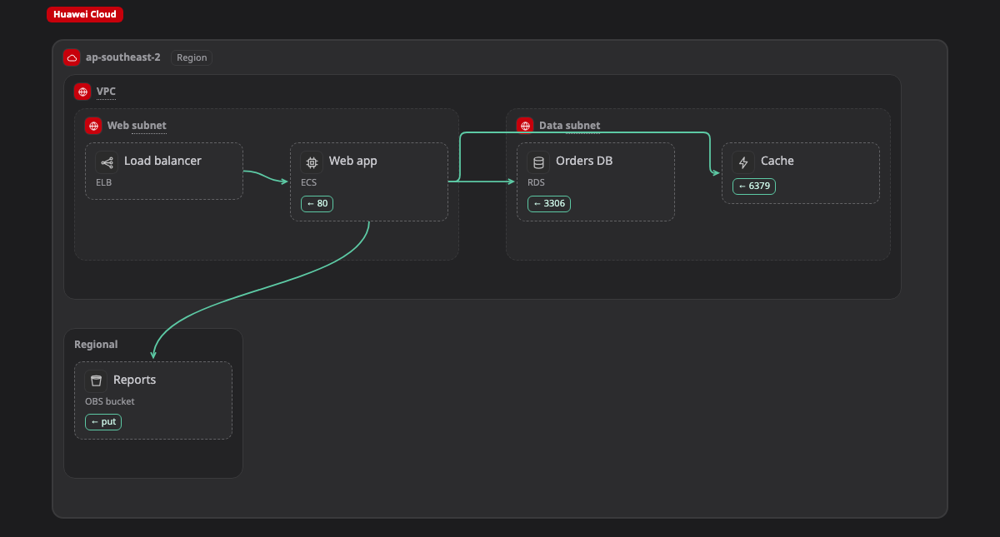

# Huawei Cloud

หน้านี้รวม kind ทั้งหมดของ Huawei Cloud ที่ Walkboard รู้จัก คือ box, zone และ line ที่วาดบน [map](../pictures/map.md) ได้ และบอกว่าแต่ละอย่างมักอยู่ตรงไหน

ถ้า box มี kind จากหน้านี้ map จะแสดง icon และ field ของมัน ถ้าวางไว้นอก zone ที่อยู่ในคอลัมน์ "มักอยู่ใน" จะมีป้าย ⚠ เล็กๆ ขึ้นข้างชื่อ เป็นแค่คำเตือน ถ้าตั้งใจวางแบบนั้นก็ไม่เป็นไร อ่านว่า kind ทำงานยังไงได้ที่หน้า[แพลตฟอร์ม](README.md)

[เปิด map นี้ใน live example แล้วคลิก box เพื่อดู kind ของมัน ↗](https://aiyaruch1320.github.io/walkboard/examples/platforms.html?view=huawei&step=all)

## Zone

zone คือกรอบที่มี box หรือ zone อื่นอยู่ข้างใน

| Kind | มักอยู่ใน | หมายเหตุ | ชื่ออื่น | Field |
|---|---|---|---|---|
| **Region** `huawei:region` | [Enterprise project](#enterpriseproject) |  |  |  |
| **VPC** `huawei:vpc` | [Region](#region) |  |  | cidr |
| **Availability Zone** `huawei:az` | [VPC](#vpc), [Region](#region) |  |  |  |
| **Subnet** `huawei:subnet` | [VPC](#vpc), [Availability Zone](#az) |  |  | cidr |
| **Security group** `huawei:sg` | [VPC](#vpc), [Subnet](#subnet), [Availability Zone](#az) | box ข้างในจะถูกเช็กกับ zone ที่ครอบมันอีกชั้น | security group, firewall | rules |
| **Enterprise project** `huawei:enterpriseproject` | ที่ไหนก็ได้ |  | project, account |  |

## Box

box คือ resource หนึ่งตัว เช่น server, database หรือ queue

| Kind | มักอยู่ใน | หมายเหตุ | ชื่ออื่น | Field |
|---|---|---|---|---|
| **ECS** `huawei:ecs` | [Subnet](#subnet) | เป็น box หรือเป็น zone เมื่อมีอะไรรันอยู่ข้างใน; มี [Container](container.md) อยู่ข้างในได้ | vm, server, instance | flavor; os |
| **CCE cluster** `huawei:cce` | [VPC](#vpc), [Subnet](#subnet) | เป็น box หรือเป็น zone เมื่อมีอะไรรันอยู่ข้างใน; มี [Kubernetes](k8s.md) อยู่ข้างในได้ | kubernetes, k8s |  |
| **CCI container** `huawei:cci` | [Region](#region), [Subnet](#subnet) |  | container |  |
| **FunctionGraph** `huawei:functiongraph` | [Region](#region) |  |  |  |
| **ELB** `huawei:elb` | [Subnet](#subnet), [VPC](#vpc) |  | lb, load balancer |  |
| **NAT Gateway** `huawei:nat` | [VPC](#vpc), [Subnet](#subnet) |  |  |  |
| **VPN** `huawei:vpn` | [VPC](#vpc), [Region](#region) |  |  |  |
| **Direct Connect** `huawei:directconnect` | [Region](#region) |  |  |  |
| **Enterprise Router** `huawei:er` | [Region](#region) |  |  |  |
| **API Gateway** `huawei:apig` | [Region](#region), [VPC](#vpc) |  |  |  |
| **WAF** `huawei:waf` | [Region](#region) |  |  |  |
| **CDN** `huawei:cdn` | ที่ไหนก็ได้ |  |  |  |
| **DNS** `huawei:dns` | ที่ไหนก็ได้ |  |  |  |
| **RDS** `huawei:rds` | [Subnet](#subnet), [VPC](#vpc) |  | db, database | engine (mysql, postgres, sqlserver, mariadb); flavor |
| **GaussDB** `huawei:gaussdb` | [Subnet](#subnet), [VPC](#vpc) |  |  |  |
| **DCS (Redis / Memcached)** `huawei:dcs` | [Subnet](#subnet), [VPC](#vpc) |  | redis, cache, memcached | engine (redis, memcached) |
| **OBS bucket** `huawei:obs` | [Region](#region) |  | bucket |  |
| **Scalable File Service** `huawei:sfs` | [VPC](#vpc), [Subnet](#subnet) |  | nfs, file share, sfs turbo | type (SFS, SFS Turbo) |
| **EVS disk** `huawei:evs` | [Availability Zone](#az), [Subnet](#subnet) |  |  |  |
| **SMN topic** `huawei:smn` | [Region](#region) |  |  |  |
| **DMS (Kafka / RabbitMQ / RocketMQ)** `huawei:dms` | [VPC](#vpc), [Subnet](#subnet) |  | kafka, queue, rabbitmq, rocketmq | engine (kafka, rabbitmq, rocketmq) |
| **IAM** `huawei:iam` | ที่ไหนก็ได้ |  |  |  |
| **KMS (Data Encryption Workshop)** `huawei:kms` | [Region](#region) |  | dew, key, secret |  |
| **Cloud Eye** `huawei:ces` | [Region](#region) |  |  |  |
| **Log Tank Service** `huawei:lts` | [Region](#region) |  |  |  |
| **SWR registry** `huawei:swr` | [Region](#region) |  | registry, image |  |
| **Flexus instance** `huawei:flexus` | [Subnet](#subnet) | เป็น box หรือเป็น zone เมื่อมีอะไรรันอยู่ข้างใน; มี [Container](container.md) อยู่ข้างในได้ | vm, server, lightweight | flavor; os |
| **Bare Metal Server** `huawei:bms` | [Subnet](#subnet) | เป็น box หรือเป็น zone เมื่อมีอะไรรันอยู่ข้างใน; มี [Container](container.md) อยู่ข้างในได้ | bare metal, physical server | flavor; os |
| **Auto Scaling group** `huawei:as` | [Subnet](#subnet), [VPC](#vpc) | เป็น box หรือเป็น zone เมื่อมีอะไรรันอยู่ข้างใน; มี [Container](container.md) อยู่ข้างในได้ | autoscaling, scaling group | min; max |
| **GPU Accelerated Cloud Server** `huawei:gpu` | [Subnet](#subnet) |  | gpu, gacs | flavor |
| **Cloud Application Engine** `huawei:cae` | [Region](#region), [VPC](#vpc) |  | serverless, container, paas |  |
| **ServiceStage** `huawei:servicestage` | [Region](#region), [VPC](#vpc) |  | paas, microservice |  |
| **Cloud Service Engine** `huawei:cse` | [VPC](#vpc), [Subnet](#subnet) |  | microservice, service registry, mesh |  |
| **Elastic IP** `huawei:eip` | [VPC](#vpc), [Region](#region) |  | public ip | bandwidth |
| **VPC Endpoint** `huawei:vpcep` | [VPC](#vpc), [Subnet](#subnet) |  | private link, endpoint |  |
| **Cloud Connect** `huawei:cloudconnect` | [Region](#region) |  | cross-region, backbone |  |
| **Global Accelerator** `huawei:ga` | [Region](#region) |  | acceleration, anycast |  |
| **Anti-DDoS** `huawei:aad` | [Region](#region) |  | ddos |  |
| **Cloud Firewall** `huawei:cfw` | [Region](#region), [VPC](#vpc) |  | firewall |  |
| **Host Security Service** `huawei:hss` | [Region](#region) |  | antivirus, edr, host security |  |
| **Cloud Bastion Host** `huawei:cbh` | [Subnet](#subnet), [VPC](#vpc) |  | bastion, jump host |  |
| **Database Security Service** `huawei:dbss` | [Subnet](#subnet), [VPC](#vpc) |  | database audit |  |
| **Cloud Certificate Manager** `huawei:ccm` | [Region](#region) |  | tls, ssl, certificate |  |
| **SecMaster** `huawei:secmaster` | [Region](#region) |  | siem, soc, security |  |
| **TaurusDB** `huawei:taurusdb` | [Subnet](#subnet), [VPC](#vpc) |  | mysql, db, database | flavor |
| **GeminiDB** `huawei:geminidb` | [Subnet](#subnet), [VPC](#vpc) |  | nosql, redis, cassandra, influxdb | api (redis, cassandra, mongodb, influx) |
| **Document Database Service** `huawei:dds` | [Subnet](#subnet), [VPC](#vpc) |  | mongodb, document, nosql |  |
| **Distributed Database Middleware** `huawei:ddm` | [Subnet](#subnet), [VPC](#vpc) |  | sharding |  |
| **Data Replication Service** `huawei:drs` | [Region](#region), [VPC](#vpc), [Subnet](#subnet) |  | migration, cdc, replication |  |
| **Data Warehouse Service** `huawei:dws` | [Subnet](#subnet), [VPC](#vpc) |  | warehouse, gaussdb dws |  |
| **MapReduce Service** `huawei:mrs` | [Subnet](#subnet), [VPC](#vpc) |  | hadoop, spark, big data |  |
| **Data Lake Insight** `huawei:dli` | [Region](#region) |  | spark, flink, data lake |  |
| **Cloud Search Service** `huawei:css` | [Subnet](#subnet), [VPC](#vpc) |  | search, elasticsearch, opensearch |  |
| **DataArts Studio** `huawei:dataarts` | [Region](#region) |  | etl, data governance, pipeline |  |
| **Data Ingestion Service** `huawei:dis` | [Region](#region) |  | stream, ingest |  |
| **ROMA Connect** `huawei:roma` | [Region](#region), [VPC](#vpc) |  | integration, esb, connector |  |
| **Cloud Backup and Recovery** `huawei:cbr` | [Region](#region) |  | backup |  |
| **Application Operations Management** `huawei:aom` | [Region](#region) |  | apm, monitor, prometheus |  |
| **Cloud Trace Service** `huawei:cts` | [Region](#region) |  | audit, audit log |  |
| **CodeArts Pipeline** `huawei:codearts` | [Region](#region) |  | ci, cd, pipeline, devops |  |
| **ModelArts / MaaS** `huawei:modelarts` | [Region](#region) |  | ai, ml, pangu, llm |  |

## Line

line ที่ไม่มี kind คือ traffic ธรรมดา ส่วนหนึ่งเรียกอีกส่วน kind ด้านล่างใช้กับ line ที่หมายถึงอย่างอื่น

| Kind | หมายถึง |
|---|---|
| `huawei:event` | Event or message |
| `huawei:peering` | VPC peering |
| `huawei:iam` | Permission (IAM) |

> **ควรรู้:** หน้านี้สร้างอัตโนมัติจาก `skills/walkboard/lib/profiles.mjs` ถ้าจะเพิ่ม kind ให้แก้ไฟล์นั้น แล้วรัน `node scripts/profiles-doc.mjs`
